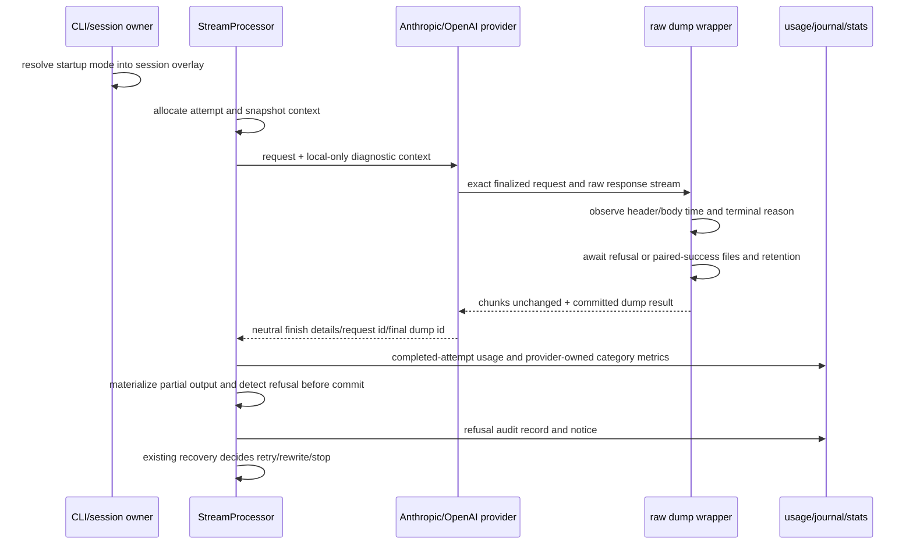

# Plan: refusal diagnosis and dump configuration (#4101)

Plan ID: `PLAN-20261114-ISSUE4101`
Generated: 2026-11-14
Issue: <https://github.com/vybestack/llxprt-code/issues/4101>
Branch: `issue4101`
Status: P01-P03 implemented; phase verification results and limitations recorded in `execution-tracker.md` and the corresponding `.completed/` records
Phases: specification P00, preflight P00.5, then A/P01 through E/P05, in order.

## Scope and execution rules

Capture the evidence needed to diagnose refused provider attempts without changing #4036 retry/rewrite policy. A refusal is a completed HTTP response with normalized finish reason `refusal`; it is not necessarily a transport error and is not inferred from zero tokens during live execution. The historical survey alone uses a labeled heuristic for older logs.

This deliverable creates only this plan. Do not switch branches, commit, push, change `.llxprt/`, run live refusal experiments, or write production code during planning. Implementation workers must follow `dev-docs/RULES.md`, `dev-docs/PLAN.md`, and `dev-docs/PLAN-TEMPLATE.md`. Use fresh coder workers for implementation phases and integration-first red/green/refactor cycles within each phase. New tests use TypeScript and `bun:test`; no new JavaScript files, Vitest suites, type assertions, or `any`. Reuse real providers, session owners, journals, token loggers and telemetry aggregation. Local HTTP/SSE endpoints and real temporary files are the test boundaries, not mocks of the behavior being tested.

The requested single-file plan contains the specification, integration analysis, contracts, numbered pseudocode, phase gates and tracker inline. No parallel implementation or disconnected diagnostic subsystem is planned. Skeleton/type additions, when needed to compile a red test, belong to that test's red cycle; do not add an independently shippable stub phase or tests of stub errors. Requirement and plan markers belong on changed declarations/tests, not explanatory comment blocks throughout untouched code.

During implementation create `project-plans/issue4101/execution-tracker.md` and `.completed/P01.md` through `.completed/P05.md`, recording the red failure, green output, changed paths and semantic checks after each phase. Do not mark this plan's research as implementation verification. At most one full final code/design review and one findings-only follow-up; OCR is skipped per Andrew 2026-10-09. Never weaken checks to obtain green results.

## P00: specification and requirements

| ID | Full requirement and observable behavior | Why it matters |
| --- | --- | --- |
| REQ-4101-A1 | Given Anthropic streaming or non-streaming output, retain `stop_details` (`type`, nullable `category` and `explanation`, optional `recommended_model`) and the HTTP `request-id` separately from the message id. Given a refusal, serialize category, explanation, recommendation when supplied, and request id into the refusal journal and token-usage turn record. New token-usage turn records carry `request_id` for successful and failed attempts too, null when the response supplied no id. | Allows individual API responses to be investigated and separates refusal categories without inventing missing evidence. |
| REQ-4101-A2 | Given any recorded refusal, show available category/explanation in refusal notices and count refusals by category in `/stats`, in addition to existing totals. A null or absent category remains null or absent in evidence; display it in an explicitly unlabeled category bucket, never as an API category. Repeated events for one attempt count once. | Makes the additional evidence visible to users and preserves existing request/error accounting. |
| REQ-4101-B1 | Given `dumpcontext=error`, an attempt ending in normalized `refusal` writes linked request and response dumps, including every received parsed SSE event and the terminal details. The first later successful provider attempt for the same prompt is also dumped, including after reviewer rewrite. Never-refused success writes no dump. Both attempts include local prompt/attempt correlation; refusal journal and usage records name the written dump base id. Other existing native-to-`refusal` mappings get this behavior too. | Produces refused/accepted evidence pairs rather than exception-only dumps. |
| REQ-4101-B2 | Given configurable age/size limits, prune the shared dump directory oldest first, keeping related request/response files together where possible. Dump or retention I/O failure never changes a request's outcome. | Prevents full-context diagnostics from filling disk. |
| REQ-4101-C1 | Given startup flags, `--dumponerror` means session-scoped `dumpcontext=error`; explicit `--set dumpcontext=<mode>` wins over that shorthand. Given no CLI override, use the user-global `settings.json` default or code default `off`. `/dumpcontext` in the running session wins over startup values and is inherited by subagents, including already-running children. `/settings` edits the install default; `/diagnostics` displays the effective mode. Remove dead Config dump flags and the `dumponerror` ephemeral registry entry while old profiles containing it continue to load. | Makes all supported configuration entry points control the provider's actual mode. |
| REQ-4101-D1 | Given a refusal after streamed text, thinking or tool-input fragments, append a bounded audit-only partial-output snapshot, output token count and elapsed first-byte-to-refusal time to the refusal record. No partial tool call executes and refused content never enters model history or replayed history. | Distinguishes pre-output refusals from refusals during generation without contaminating the next request. |
| REQ-4101-D2 | Given a refused attempt, record changes since this session/runtime's last successfully committed model attempt: added entry identities and bounded previews, compression activity and actual summary author, and provider-reported prompt/cache-read counts. Capture the request's context at the send boundary, not a later mutable history snapshot. | Supports diagnosis of changed context and compression without treating correlation as causation. |
| REQ-4101-E1 | Given current and older fixture logs and dumps across project directories, `bun scripts/refusal-survey.ts` produces readable output and JSON with runs, evidence, recovery, category/model/project counts, compression correlation and paired-window term comparisons. Discover paths through storage resolution, stream logs, use no network and perform no replays. | Replaces machine-specific Python exploration with reproducible offline analysis. |

Out of scope: replay/bisection against an API; changing refusal budgets, backoff, reviewer choice or rewriting; treating `safety`/`content_filter` as a refusal; broad provider API upgrades; rewriting historical logs; changing session retention policy.

## P00.5: researched preflight and integration map

The issue and its comments were read with the GitHub tool. The branch was verified as `issue4101` and the worktree was initially clean. The date command returned 2026-11-14. No implementation tests have been run for this planning task.

### Dependencies and infrastructure

Installed dependency check: `npm ls --depth=0 @anthropic-ai/sdk openai ai zod fast-check` succeeded. Bun is 1.4.4; installed Anthropic SDK is 0.55.1, OpenAI is 5.23.2, AI SDK is 7.0.83, Zod is 3.25.76. Root fast-check is 4.5.3 and workspace fast-check is 4.8.0. No new dependency is needed. In particular, do not assume this older Anthropic SDK declares `stop_details`: parse the external object as `unknown` through a small Zod boundary schema instead of upgrading the SDK or casting to a newer shape.

Existing real integration infrastructure:

- `packages/agents/src/api/__tests__/helpers/refusal-endpoint.ts`: `runScriptedPrompt`, `startScriptedEndpoint`, `turnRecords`, real Agent creation, recording and token-log reads. `ScriptedRun` already exposes events, stats, history, wire requests, token records and journal records.
- `packages/agents/src/api/__tests__/helpers/anthropic-refusal-endpoint.ts:30-86`: `renderAnthropicReply` emits Messages SSE; `startAnthropicEndpoint` currently emits only finish replies, not details, custom headers, JSON replies or unfinished tool input. Extend the fixture grammar, rather than cloning the endpoint.
- `packages/agents/src/api/__tests__/refusalRecovery.anthropic.behavior.test.ts` proves real metadata-only refusals and identical resend. `refusalReview.behavior.test.ts` provides reviewer/rewrite scenarios. Reuse both for new diagnosis assertions.
- `packages/agents/src/core/__tests__/subagentOrchestrator-sessionInheritance.test.ts` and `packages/settings/src/settings/SessionSettingsOverlay.ts` cover the existing shared session overlay.
- `packages/providers/src/utils/dumpContext.separateFiles.test.ts`, `dumpSDKContext.test.ts`, Anthropic/OpenAI `*separateDump.test.ts` and `AnthropicApiExecution.dumpContext.test.ts` are neighboring dump tests. New cases must inspect actual files, not assert dump-writer mock calls.

Before implementation, rerun the relevant existing tests and record results under `tmp/verify4101/`. Confirm package builds/source resolution for direct Bun tests. If a declaration or harness assumption below has drifted, update the contract before writing production code. An absent new field should cause an assertion failure through an existing public path, not a missing import failure.

### Actual data paths and loss points

| Boundary | Evidence and current behavior | Required change / consumer |
| --- | --- | --- |
| Anthropic stream parsing | `packages/providers/src/anthropic/AnthropicStreamProcessor.ts:193-205, 633-733`: `applyStreamEvent` calls `handleMessageDelta`; `readMessageDeltaStopReason` reads only `delta.stop_reason`. `message_delta` without usage still emits finish metadata. | Parse details in both usage/no-usage branches. Emit neutral finish diagnostics, retaining nulls. |
| Anthropic JSON response | `packages/providers/src/anthropic/AnthropicResponseParser.ts:153-195`: `parseAnthropicResponse` maps only `message.stop_reason`. `anthropic/finishReasonMapping.ts:17` maps `refusal` directly. | Use the same boundary parser and neutral diagnostic shape for JSON and SSE. |
| Headers before provider output | `packages/providers/src/anthropic/AnthropicApiExecution.ts:245-247, 359-410`: execution returns `responseHeaders`. `AnthropicProvider.ts:704-744` `executeWithImageRecovery` reconstructs a result without them; `executeImageDimensionRecovery` has the same return contract. `yieldResponse` at 991-1030 only receives the message/stream. | Preserve response diagnostics in normal and image-recovery results; read the id of the actual response and pass it to JSON/SSE output. Do not use `message.id` as HTTP request id. |
| Neutral output conversion | `packages/core/src/services/history/IContent.ts:163-166`; `packages/core/src/llm-types/modelEnvelope.ts:53-67, 123-131, 270-275`: `toModelStreamChunk` explicitly copies known fields, `accumulateModelStreamChunk` explicitly accumulates them. | Add diagnostic fields at both boundaries. `MessageConverter.ts` is history conversion/curation, not this stream finish bridge. Changing it alone would not work. |
| Stream evidence and journal | `packages/agents/src/core/StreamProcessor.ts:737-802` `_convertIContentStream` retains only finish reason/raw reason for telemetry; `processStreamResponse:808-874` materializes `StreamOutputAccumulator`, then calls `throwIfRefused` before validation/commit. `refusal/refusalDetection.ts:34-46` drops other metadata. `refusalTypes.ts:18-34`, `refusalJournal.ts:14-45`, `packages/core/src/recording/refusalPayload.ts:15-40` define the narrow evidence/payload. | Extend the whole chain, including `refusalSettlement.ts:settleRefusal/settleResolved`. Refusal records remain audit events; `SessionRecordingService.recordRefusal` and ReplayEngine validate but never insert them into history. |
| Usage records | `packages/agents/src/core/streamTelemetryLogger.ts:234-272` `emitStreamTelemetry`; `tokenUsageActualLogger.ts:58-94, 108-182, 191-237`; `TokenUsageLogger.ts:456-464` `_toSerializedTurnRecord` and `_serializeExtraFields`; `tokenUsageRecords.ts:58-137` serialized schema. | Carry finish diagnostics through stream and direct-turn paths, `TokenUsageActualInput`, serializer, tolerant reader and abandoned/error records. Reset fields per attempt so accepted retries cannot inherit refusal details. |
| Prompt and attempt identity | `packages/agents/src/core/streamChatOptions.ts:22-65` passes `LOGICAL_REQUEST_ID_KEY` (`__logicalRequestId`) in metadata. `StreamProcessor.ts:108, 164-177, 567-619, 650` already knows current attempt index. `refusalTurn.ts:130,139` advances using `RefusalRecovery.allocateAttempt`. `_resendKeptRequest` rebuilds chat options around the kept wire request. | Add local-only attempt context at both preparation and actual send; do not change request bytes for identical resend. Never guess the attempt index from a new provider-local counter. |
| Direct generation | `packages/agents/src/core/DirectMessageProcessor.ts:346-512, 574-576` consumes/accumulates IContent and passes logical request id. `tokenUsageActualLogger.ts:syncAndRecordTurnUsage` supplies direct usage records. | Preserve new diagnostics through direct response accumulation and `TurnProcessor`'s usage call. JSON-only provider tests must not be mistaken for proof of the Agent path. |
| Stats | `packages/providers/src/logging/streamProcessor.ts:recordChunkToAttempt` feeds `attemptRecorder.ts:209-230,270-285`; `telemetryEmitter.ts:37-81,95-165` emits provider-owned ApiResponseEvent. `packages/telemetry/src/telemetry/events/api-events.ts:75-133`, `uiTelemetry.ts:257-263,429-464`, `sessionMetricsAggregator.ts:263,472-499` currently know refusal boolean only. | Add category to provider-owned attempt telemetry, not a second agents-layer count. Preserve deduplication, model/session isolation and reset. Update `ModelStatsDisplay.tsx` and `SessionContext.tsx` comparison so category-only changes rerender. |
| Notices | `packages/agents/src/core/turn.ts:182-223` emits Finished values with raw stop reason; `packages/core/src/core/turn.ts:294-309` types them. `packages/cli/src/ui/hooks/agentStream/streamUtils.ts:316-323` `buildRefusalNoticeMessage` returns a fixed string. `core/src/utils/refusalNotice.ts` supplies shared text; `agents/src/refusal/refusalNotices.ts` supplies retry/review/stop text. | Carry evidence into events and format it once for interactive, headless and A2A consumers. Recovery notices must also carry available details, because a recovered refusal may not produce a terminal refusal notice. |
| Dumps | `packages/providers/src/utils/dumpContext.ts:150-172` `shouldDump`; `dumpRequestContext:204-237`, `dumpResponseContext:243-281` use `Storage.getGlobalCacheDir()/dumps`. `dumpSDKContext.ts:214-354` stores chunks but error-only dumping runs only on throw. `AnthropicApiExecution.ts:320-355` wires that wrapper. | Detect refusal at the raw response boundary and publish a committed dump id before agents-layer telemetry/journaling. Preserve all parsed SSE events, not just assembled text. |
| OpenAI scope | `openai/finishReasonMapping.ts:22-33` maps native `refusal`, but maps `content_filter` to `safety`. `OpenAINonStreamHandler.ts:290`, `OpenAIStreamTerminalContent.ts:106`, `OpenAIStreamProcessorState.ts:425,468` consume it. `OpenAIApiExecution.ts:296-497` has the same exception-only gap. `openai-vercel/vercelMetadataMapper.ts:buildMetadata` also uses this mapper. `openai/parseResponsesStream.ts:387-448` maps Responses status, not refusal content. | Chat Completions SSE/JSON get refusal dumps and pairing. Apply the same normalized-outcome dump contract to Vercel when it produces `refusal`; do not silently exclude this mapper consumer. Do not introduce new refusal classification for Responses content or reinterpret `safety`. |
| Startup settings | `packages/cli/src/config/yargsOptions.ts:357`, `cliArgParser.ts:77,211`, `configBuilder.ts:226` pass the flag into dead Config state. `core/src/config/configTypes.ts:383`, `configConstructor.ts:111,427`, `configBaseCore.ts:90,389-391` define it; repository search found no getter consumers. | Keep CLI spelling, remove Config state and route startup to the session owner. |
| Session setting writes | `packages/settings/src/settings/registry/registry-entries-2.ts:265-294` registers both keys, with dumpcontext session scope. `SettingsService.ts:157-173,213-230` overlay reads/writes; `SessionSettingsOverlay.ts` shares it with children. `cli-ephemeral-settings.ts:20-77` parses --set. `postConfigRuntime.ts:applyEphemeralSettings` adapts all keys to `writeUserParameter`, not `writeSessionOverride`. | Dispatch session-scoped CLI keys to the session owner, including argument reapplication after provider activation. `AgentPostConfigSettings` in `packages/agents/src/api/profile-preflight.ts` currently needs a narrow session-write capability. |
| Install default and diagnostics | `packages/cli/src/config/settings-schema/schema-core.ts:79-91` emojifilter is an application-owned example. `core/src/profiles/reduction/reduceSetCommand.ts:44-57` rejects application-owned profile keys with `/settings` guidance. `diagnosticsCommand.ts:335-353` wrongly consults `dumponerror`. `dumpcontextCommandHost.ts:bindDumpcontextCommand` already accepts owner read/write operations. | Add validated persistent setting/dialog entry and use effective session mode everywhere. Keep dumpcontext non-profile-persistable. |
| Compression evidence | `HistoryService.ts:683-716` has compression lifecycle events; `getChronologyTrace:743-745` returns compact identity/structure. `HistoryServiceCore.ts:634,969,991` publishes single/batch additions and rollback. `OneShotStrategy.ts:221-233` and `MiddleOutStrategy.ts:655-669` mark summaries but store no summary-author model. `CompressionHandler.ts:626-679,929-954` applies results/emits events. `compressionLifecycleTelemetry.ts:36-46,106-125` re-resolves a configured model after compression. | Keep a compact attempt audit cursor; obtain author from the actual summary-producing route, not the current model or a later resolver call. |
| Survey paths | `packages/storage/src/config/path-resolver.ts:135-148` resolves log root; `storage.ts:422-431` defines global/project temp dirs. Dumps use cache root, not log root. `core/src/recording/types.ts:71-99` defines `{v,seq,ts,type,payload}` and session_start identities. | Script imports source path resolver, joins log root with `tmp`, and cache root with `dumps`, honoring overrides and working before package builds. |

### Prototype findings

Read all three ignored local prototypes: `tmp/refusal-survey/scan_usage.py`, `correlate.py`, `compact.py`. Reuse their analysis intent: enumerate usage turns, group refusal bursts by prompt, locate the preceding compression and recent content, and show compression distance plus compact block previews. Do not port their hardcoded macOS path, modification-time cutoff, project-to-chat filename table, filename-only grouping, broad silent exception skips, or lexical hour comparison. `correlate.py`'s bisect by timestamp is only an approximate legacy fallback; journal `seq` is the ordering authority. `compact.py` counts records since compression, which includes audit events; the new report must distinguish content-entry distance from record distance.

## Integration contracts and design decisions

### A. Neutral evidence and serialized names

Use an optional schema-derived neutral `stopDetails` object beside `finishReason`/`rawStopReason`, with `type: string`, `category: string | null`, `explanation: string | null`, optional `recommendedModel: string`. Accept category strings beyond today's five categories because the API boundary can evolve; preserve them verbatim. The external parser maps `recommended_model` once. Missing details stay absent, explicit null category/explanation stay null, malformed supplied fields produce a bounded parse diagnostic and are omitted without masking an otherwise valid refusal. Stop reason remains sufficient to recognize refusal.

Add a separate nullable `requestId` diagnostic. It is not `responseId`/message id. Request id can be published on the first metadata-only chunk and retained through later chunks. Strip internal audit diagnostics from history commits and API-bound serialization; store them in records/events, not prompt content. AfterModel hooks may rewrite content but must not erase or manufacture provider-owned request id/details: preserve those fields from the provider observation independently of hook replacement output.

Persist `refusal_category`, `refusal_explanation`, `recommended_model`, `request_id`, and `dump_base_id` in new refusal payloads and token records. Both category/explanation are nullable and optional for old records; preserve omission versus null. Every newly written turn record includes nullable `request_id`, including error/abandoned attempts that never received a response. `dump_base_id` is present only when the linked dump pair has actually been written. Keep existing envelope/schema versions for additive optional evidence, with nullable request id accepted in the reader. Old files are read unchanged.

Category aggregation uses a structured nullable category or an internal bucket enum; the UI label `Unspecified` is presentation only. No API record is rewritten to `general_harms` or `unknown`. Count only normalized refusal attempts. Retain total requests, real usage and zero errors for HTTP-200 refusals.

### B. Raw capture, prompt identity and paired success

Choose raw-provider outcome inspection in the dump wrapper, not throwing from the dump utility and not waiting for an agents exception. Extend the shared SDK dump wrapper with a provider-owned outcome selector. Anthropic's selector inspects `message_delta.delta.stop_reason` or JSON `stop_reason` through `mapStopReason`; OpenAI Chat's selector inspects `choices[].finish_reason` through `mapFinishReason`. An empty-choice usage event after the finish must not erase the outcome. Keep HTTP status 200 for refusal dumps and add a separate attempt outcome field. Existing true transport-error dumps retain their error behavior.

Pass a narrow local-only attempt diagnostic context through `options.metadata`: prompt id from `LOGICAL_REQUEST_ID_KEY`, agents attempt index, runtime/session identity, paired-success intent, retention limits, and an observation callback/result holder for dump completion and first-response-byte timing. It must never be spread into a provider request body. Define the typed contract in providers (with a metadata-key reader), imported by agents, to avoid a reverse package dependency. It owns local diagnostics, not retry decisions.

The agents ChatSession/StreamProcessor lifetime owns pending pairing per prompt, not a provider-global map. On an observed refusal mark that prompt as awaiting its first successful provider response; the next attempt context carries that state. Further refusals continue to dump and retain pending state. Network failures, cancellation, stream truncation and missing/unsuccessful terminal reasons do not consume the pending pair. A normally completed response with terminal `stop`, `tool_calls` or `max_tokens` satisfies pairing; `refusal`, `safety`, `error`, `other` and no terminal reason do not. This defines “success” here as provider completion, not successful execution of tools or a claim that a subsequent content validator accepts the output. It must not alter existing usage outcome semantics.

An identical refusal resend keeps the exact request bytes. A reviewer rewrite rebuilds context but reuses the prompt id and increments the same attempt index. Clear pair state when captured or when that logical request is permanently released, stopped, canceled or disposed. Children and concurrent sessions with equal prompt ids must not share pending pairs. A later refusal for a still-active prompt starts a new pending pair; success-success after one refusal dumps only the first success. Provider-only calls without agents context still dump refusals; use explicit nullable local identity rather than fabricate a join to a session. Public Agent calls must always supply identity.

Wait for wrapper completion and pair-file writes before publishing `dumpBaseId` to the final metadata-only IContent, so `_convertIContentStream` sees it before `logStreamTelemetry`, and `processStreamResponse` sees it before `throwIfRefused`. Do not publish it on `message_delta` before the wrapper's final write. Preserve the earlier terminal fields when this trailing metadata-only chunk arrives. One attempt gets one base id in `on` mode too, without duplicate refusal dumps.

The response dump captures parsed SSE events in arrival order, including `message_start`, deltas, terminal details and `message_stop`. The existing format is parsed SDK events, not byte-for-byte HTTP framing. This meets the issue's event-content criterion without pretending to preserve raw HTTP bytes. Do not add another full-context buffer: reuse the wrapper's existing accumulated events and request object for this work, release them at end/abort, and avoid starting capture in `off` mode. Bound the journal snapshot separately; never truncate the requested refusal SSE dump under a journal-size cap.

Vercel uses the same mapper in `vercelMetadataMapper.buildMetadata`, so it gets the same normalized refusal/pair decision. Its transport does not use `OpenAIApiExecution`; integrate capture with `createReasoningCaptureFetch`/the existing request-fetch boundary and await capture completion before final metadata. Do not serialize only the assembled AI SDK answer and call it a full stream dump. Keep the existing reasoning-reader cancellation discipline. Responses HTTP/WebSocket paths currently map response status; no new classification of `response.refusal.*` is included. Their existing dumps still receive shared retention.

### C. Retention and storage

Proposed user settings: `dumpRetention.maxBytes = 2147483648` (2 GiB), `dumpRetention.maxAgeDays = 14`. Both are positive finite values; byte count is an integer. These are user-level application settings, not profile fields. Seed validated effective limits into the same runtime/session diagnostic inputs used by dumps; no per-write settings-file reads. Add setting definitions in B and wire their persisted CLI application in C. Existing callers with no explicit limits use these code defaults.

The observed issue rate is 220 refused attempts over roughly 13 days, about 17/day. A real local refused-request fixture produced a linked request/response pair of 105,287 bytes (six parsed SSE events). At that size, the 2 GiB cap holds 20,396 pairs. If every refused attempt also produces one accepted pair, 17 refusals/day would generate about 47.8 MiB over 14 days, so the age cap would control retention for this fixture; this does not predict larger real prompts or `on` mode traffic. Thus 2 GiB and 14 days are a bounded starting policy, not a guarantee of a minimum retention period. `on` mode and arbitrarily large requests make any unconditional “several days” guarantee impossible under a fixed size cap.

Prune completed dump groups by oldest timestamp/mtime first: remove expired groups, then oldest remaining groups until total managed-file bytes fit. The pair is the base-id unit; request and response stay together. Include old standalone dump formats and orphans in the budget using their actual file sizes, without deleting unrelated files, directories or symlink targets. When a single completed pair exceeds the configured cap it can be evicted as a unit; report that outcome and do not claim a usable `dump_base_id`. Protect current in-progress writes; coordinate request/response lifecycle so pruning cannot delete a request while its response is still being written. Run pruning after final pair publication and for immediate/request-only dumps. Use atomic file publication plus a per-directory in-process write/prune queue. Other processes sharing the cache can race: handle disappearing files at this external filesystem boundary and converge on the next pruning pass. Do not claim cross-process transactional size enforcement.

Use the existing `bestEffortDump` boundary for write/prune failures, including ENOSPC, permissions and ENOENT races. Inner pure selection/grouping code should fail fast on violated internal contracts; do not add repeated try/catch fallbacks to provider logic. Store no credentials from headers: reuse `redactSensitiveHeaders` and media diagnostic sanitization. Dumps and partial-output journals contain prompt content and thinking, so use restrictive file permissions and say so in the settings/help text.

### D. Mode precedence and ownership

Persistent modes are `off`, `error`, `on`. `now` and `status` remain `/dumpcontext` actions, not persistent startup settings. Reject these actions as settings defaults or `--set` modes with a clear error; do not persist a command that providers interpret as “do not dump.” Keep the command's existing immediate-dump behavior.

Apply startup sources once after provider/profile activation: code default, user-global setting, `--dumponerror=true`, explicit parsed `--set dumpcontext`. Last explicit `--set` entry wins in argv order. The shorthand flag never forces `off` when false/absent. All effective startup modes go into the foreground session overlay, so profiles cannot replace them and children inherit them. A subsequent `/dumpcontext off` replaces that overlay value and remains highest priority. Do not reapply startup args on later profile switches in a way that overwrites a user's session command. Update both `applyEphemeralSettings` and the earlier argument-override path to use the session-scoped writer for classified keys; retaining a shadow named value creates a second source of truth.

`dumpcontext` remains application-owned and excluded from profile persistence. Remove the `dumponerror` registry entry and dead Config fields/getter, not the public `--dumponerror` spelling. Historical profile keys may be tolerated and ignored; do not create an alias that makes them active again. Keep `profileParser.issue2642.test.ts`'s load-tolerance assertion, and update registry tests that currently assume the removed key has an active registry spec. User-global means read `LoadedSettings.user.settings`, not an untrusted workspace's merged value that can enable context capture. `/settings` must expose the field at User scope and save it to that file; use the same rule for retention. Declare these persistent defaults restart-required so changing them applies to new sessions and never unexpectedly overrides a running session command/CLI mode. `/dumpcontext` remains the immediate session control. `/diagnostics` always prints the effective mode, including `off`, and directory/retention information from the same resolved inputs.

### E. Bounded partial output and context fingerprint

At `StreamProcessor.processStreamResponse`, the accumulator has all emitted text and coalesced thinking before `throwIfRefused`. It does not have unclosed tool input: `AnthropicStreamProcessor.handleContentBlockDelta` appends `currentToolCall.input` privately and emits a ToolCallBlock only at `content_block_stop`. Capture unfinished tool input there as terminal audit metadata on a refusal, never as an executable ToolCallBlock. Also preserve finalized tool-call input that arrived before refusal. A complete tool call before the terminal refusal must still be discarded by existing refusal settlement.

Journal `partial_output` contains ordered typed previews: text, thinking, tool id/name with raw input text and completeness. Coalesce thinking updates by stream id to avoid repeated full-thought snapshots. Cap the combined preview payload at **32 KiB UTF-8 per refusal**, counting text, thinking and tool input under one budget. Mark `truncated` and original byte counts explicitly; truncate at valid UTF-8 boundaries. Do not retain signatures, raw media bytes or invent missing JSON to make incomplete input parse. Include reported `output_tokens`; zero is distinct from unreported. Emit empty partial-output evidence for pre-output refusals.

“First byte” means first nonempty response-body bytes observed at transport read, not TTFT, SDK metadata creation, request start or the time a buffered tool call becomes visible. Add this measurement at the response-body read boundary used by Anthropic transport and pass it through the local attempt context. Record `first_byte_to_refusal_ms` as a nonnegative monotonic duration ending when the refusal terminal event is parsed; use null if no byte timestamp is available. Keep existing TTFT/generation fields unchanged. Non-streaming responses can report body-receipt timing when observed, otherwise null. This does not establish whether input or generated output caused a classifier decision; it only identifies what had arrived before the refusal.

Use one small audit tracker owned by the ChatSession/runtime, shared between its StreamProcessor and compression lifecycle but never between subagents. Maintain the last successfully committed attempt cursor and compact additions/compression events since that cursor. Capture bounded structural references and previews as entries are added, including batch additions; handle rollback, rewrites, history replacement and compression rebuild suppression using the same event/origin conventions as `RecordingIntegration`, not naive history-length subtraction. Keep exact counts but at most 128 recent entry previews with a combined **32 KiB UTF-8** budget; include omitted counts and chronology ids so the survey can consult the journal. Count synthetic compression-summary/continuation entries separately from ordinary additions. Pending user entries not yet committed are listed separately from committed additions; identical retries do not duplicate them. Do not retain full history objects or reread journal files at each send.

At the final enforced/hooked send snapshot (`_sendProviderRequest`, and the kept-request resend path), attach a compact fingerprint: baseline prompt/attempt/time, added identities/count/previews, pending-entry identities/previews, compression count since success, last compression time, actual summary-author model/provider or null, and a deterministic SHA-256 digest of ordered entry identity/structure plus content hashes. Hash text/tool content incrementally without materializing a serialized full prompt. Hash changes from reviewer edits even when their chronology ids do not change. This is a comparison fingerprint, not a claim to hash exact wire bytes or the same thing as existing prefix-cache fingerprints.

Add provider-reported prompt and cache-read counts at refusal finalization from the accumulated usage, using the same cache precedence as `usageStatsToActualInput`. Do not substitute estimated counts into reported fields; provide estimates separately only if useful and labeled. A success advances the baseline after history commit, not after HTTP completion; a refusal never advances it. Reset/rebind on clear, resume and runtime disposal, recording baseline unavailability explicitly rather than treating a fresh runtime as knowing a historical success.

Summary provenance must be captured from the actual resolved summarizer in OneShot/MiddleOut (and verification pass if it authored the final text). Carry an audit provenance object on `StrategyCompressionResult.metadata`, through `CompressionHandler` to the compression-ended record/tracker and token lifecycle record. For purely structural/truncation compression record author null and strategy name, not the current session model. Existing compression events may have no author and historical data may be unrecoverable. Keep this new provenance outside model content: extend the compression event/payload contract rather than inserting refusal audit fields into summary text or prompt metadata.

## Component lifecycle



All dump completion and record writes at the attempt boundary are awaited. Cancellation closes raw capture and removes attempt-local references. No fire-and-forget prune or journal mutation. The provider wrapper remains the source of metrics; the agents finalizer remains the source of refusal settlement and successful history commits.

## Numbered implementation pseudocode

Each implementation step below cites these lines. Amend the plan before deviating from a contract, rather than adding fallback behavior around an internal mismatch.

```text
01 Parse external stop details once; map wire names to neutral names and preserve explicit nulls.
02 Read response request-id at execution; carry it through every normal/recovery output route.
03 Copy neutral diagnostics through IContent -> ModelStreamChunk -> accumulated ModelOutput.
04 Preserve provider diagnostics independently of content hook replacements.
05 Serialize new evidence in usage/refusal records; omit unreported details, preserve explicit nulls.
06 Add category to provider-owned attempt telemetry; aggregate once and render notices/stats.
07 Allocate local attempt diagnostics from prompt/runtime/agents attempt index at actual send.
08 In dump-enabled raw capture, append every received event and retain newest terminal outcome.
09 On refusal or eligible paired success, await linked dump files using one base id and local correlation.
10 Prune completed managed groups by age, then size; return usable base id only if files remain.
11 Publish completed dump result before final provider metadata reaches usage logging/refusal detection.
12 Mark pending pairing on refusal; consume only a qualifying provider success; release with prompt lifecycle.
13 Validate install settings and CLI modes at their external boundary; keep now/status as command actions.
14 After profile activation seed session overlay: user default, shorthand, then explicit --set.
15 Route session-scoped CLI writes through owner; later /dumpcontext replaces overlay without CLI reseeding.
16 Remove dead Config/ephemeral paths; display effective mode including off; retain inert profile tolerance.
17 At raw response reads record first-byte time; at refusal terminal parse record elapsed monotonic duration.
18 On refusal snapshot accumulator output plus unfinished tool input into bounded audit previews only.
19 Track compact additions/rollbacks/compressions and actual summary authors, independently of model history.
20 Snapshot request fingerprint after hooks/enforcement; attach reported usage at refusal finalization.
21 Advance audit baseline only after successful commit; reset/rebind/release tracker with session lifecycle.
22 Discover log/cache roots through storage; enumerate project logs and stream JSONL with file/line diagnostics.
23 Classify explicit refusals or labeled older-Claude suspects; join by exact identities before timestamp fallback.
24 Group per project/session/runtime/prompt; correlate compression/content/rewrite/recovery and dump pairs.
25 Aggregate model/category/project counts and compression denominators; compare matched-pair term frequencies.
26 Render deterministic readable and JSON reports; write only requested report output, never modify inputs.
```

## Phase A / P01: stop details, request id, records, notices and category stats

**Phase ID:** `PLAN-20261114-ISSUE4101.P01`
**Prerequisite:** P00.5 verified, contracts above agreed by the implementing worker.
**Requirements:** REQ-4101-A1 and A2, full behavior specified in the requirements table and sections A/lifecycle above. Given external details and headers, when an attempt completes, records, user notices and deduplicated stats expose that evidence. Implement pseudocode 01-06.

### RED: integration tests first

1. Create `packages/agents/src/api/__tests__/refusal-diagnostics.behavior.test.ts`. Extend existing endpoint helpers to emit distinct request-id headers per reply, `stop_details` and JSON/non-stream responses. Drive real Agent calls through Anthropic SSE and `streaming=disabled` JSON. Assert refusal journal and token turn records agree on prompt/attempt/category/explanation/request id; recommendation is retained when supplied. Successful retry has a different request id and no carried-over refusal fields. Assert real history excludes refusal output. Begin with category `cyber`, then null category/explanation, absent details, details without terminal usage, and an unrecognized future category. Distinct message/header ids prove the id source. Exercise recovery off, retry and rewrite notices.
2. Add cases in that file for two responses with different headers and a transport error after receiving headers. Inspect the failed/abandoned usage record's id; a failure before headers records null. Include a content hook that replaces terminal content, demonstrating provider evidence survives hook content replacement. A test must fail if metadata is lost at any intermediate bridge.
3. Extend `packages/core/src/recording/SessionRecordingService.refusal.test.ts`: write new nullable evidence and an old payload to actual JSONL, replay with real ReplayEngine, assert added audit fields persist and replayed model history is unchanged.
4. Extend `packages/telemetry/src/telemetry/refusalCounting.behavior.test.ts`: feed real provider-owned events through UiTelemetryService with cyber/null/absent/future categories, duplicate attempt event, another model and another session. Assert total and per-model bucket counts, zero added errors, no count for safety, and reset empties category counts. Add a real-provider integration assertion from the endpoint so synthetic event tests alone cannot satisfy A2.
5. Create `packages/cli/src/ui/components/refusal-category-stats.test.tsx` using existing Ink rendering harness: category counts render alongside total refusals; update only categories and assert refreshed visible output. Create `packages/cli/src/ui/hooks/agentStream/refusal-diagnostics-notice.test.ts` for the public notice formatter and event handling, plus cases in `nonInteractiveCliSupport.refusalNotice.test.ts` and A2A `executor.refusalNotice.test.ts`. Assert category/explanation appear when supplied, null is not printed as a category, and the original message remains unchanged without details. Include retry/review/stop surfaces, not only terminal Finished.

### GREEN and integration tasks

- Update existing `IContent.ts`, `finishReasons.ts` (or a small co-located schema-derived diagnostic type), `modelEnvelope.ts`, provider parsers, AnthropicProvider's normal/image-recovery return contracts and `yieldResponse`. Preserve id even when there is no usage. Do not equate stop details with a new finish reason.
- Update stream finish collection, hook-preservation boundary, direct response accumulation and `TurnProcessor` usage call; extend `RefusalEvidence`, `RefusalAttempt`, `toRefusalPayload`, RefusalPayloadSchema and token record schemas/serializer/reader. Follow every explicit field mapping in `tokenUsageActualLogger` and `_serializeExtraFields`, not only the serialized Zod shape.
- Add request id to failed/abandoned token contexts as soon as observed, with per-attempt reset. Introduce the minimal typed response-observation contract in providers during A for headers observed before any IContent can be emitted; B extends that same contract with dump identity/pairing, rather than creating another bridge. Record ids from SDK error response headers when supplied at that external boundary. No stale request id can survive a retry without headers. Do not create token usage numbers for requests that supplied none merely to attach an id; extend any existing no-usage turn serializer path to carry null/observed id.
- Update `logging/streamProcessor.ts`, AttemptRecorder state and both emitters, ApiResponseEvent, UiTelemetryService and SessionMetricsAggregator. Update any core telemetry re-export/contract, public Agent stats projection and CLI model/session metrics types as typecheck requires.
- Update shared refusal formatter and its callers; pass details via Finished event and existing recovery notice construction. Escape/control-character sanitize untrusted explanation text for terminal display without changing stored evidence. Do not render audit thinking/tool input in notices.
- Add focused parser/neutral-envelope tests after integration tests, extending `anthropic/finish-metadata.test.ts` and `core/src/llm-types/finish-metadata.test.ts`. Test null preservation and metadata-only follow-up chunks. Use fast-check generated nullable detail/string inputs for pure transformations and category aggregation invariants.

### Verification

```bash
bun test packages/agents/src/api/__tests__/refusal-diagnostics.behavior.test.ts
bun test packages/agents/src/api/__tests__/refusalRecovery.anthropic.behavior.test.ts
bun test packages/core/src/recording/SessionRecordingService.refusal.test.ts packages/core/src/llm-types/finish-metadata.test.ts
bun test packages/telemetry/src/telemetry/refusalCounting.behavior.test.ts
bun test packages/cli/src/ui/components/refusal-category-stats.test.tsx packages/cli/src/ui/hooks/agentStream/refusal-diagnostics-notice.test.ts
bun test packages/cli/src/nonInteractiveCliSupport.refusalNotice.test.ts packages/a2a-server/src/agent/__tests__/executor.refusalNotice.test.ts
npm run typecheck
```

**Gate:** exact values in persisted records match endpoint evidence; nulls survive round trip; accepted output has no stale refusal fields; rendered stats/notices work through their real consumers; no extra metrics event source. Record red and green results before B.

## Phase B / P02: refusal dumps, paired success and retention

**Phase ID:** `PLAN-20261114-ISSUE4101.P02`
**Prerequisite:** A green; neutral diagnostic bridge and record fields exist.
**Requirements:** REQ-4101-B1 and B2. Given error mode and refusal, when raw response completes, write linked files and later the first accepted partner for that prompt; prune managed files without affecting requests. Implement pseudocode 07-12. Persistent settings definitions for retention are introduced here; startup application is completed in C.

### RED: integration tests first

1. Create `packages/agents/src/api/__tests__/refusal-dumps.behavior.test.ts`. Isolate `LLXPRT_CACHE_HOME` and log/config roots with a unique fixture directory before Storage is used. Reuse `runScriptedPrompt`, extending its options/results to inspect dumps before cleanup. A cyber refusal in error mode writes exactly one request/response pair. Inspect actual JSON files: linked filenames/base id, untouched request body, ordered SSE events containing details, status 200, prompt/attempt/runtime identity as envelope siblings. Journal and token record `dump_base_id` resolve to these files. Assert credential headers are redacted.
2. Refusal then stop on same prompt yields two distinct base ids and one prompt id, attempt indices 0 and 1, and explicit refusal/paired-success outcomes. Refusal-refusal-success yields three pairs; the next success adds none. A never-refused success, another prompt's success, safety finish, and mode off yield no refusal/pair dump. Mode on does not duplicate a pair. Transport error between refusal and success does not consume pending pairing; abort/truncation does not become accepted success. Two session/runtime owners using equal prompt ids do not cross-pair.
3. Reuse the real reviewer endpoint/harness from `refusalReview.behavior.test.ts` for refused request -> reviewer rewrite -> accepted resend. Inspect differing request bodies and stable prompt plus incremented attempt id. Reviewer traffic cannot consume the original prompt's pending pair. Repeat core cases with Anthropic JSON and OpenAI Chat SSE/JSON. Include a completed tool-call response as the accepted partner and a trailing empty-choice usage chunk so outcome retention is exercised.
4. Create `packages/providers/src/openai-vercel/refusal-dumps.behavior.test.ts`, exercising real provider/AI SDK against the local compatible endpoint, without mocking `streamText` or metadata mapper. Assert full captured response events and pairing for a provider output that maps to `refusal`. The fixture must use a native finish shape the adapter actually maps; if AI SDK normalizes it differently, document the observed mapping and fix the existing passthrough only as needed to preserve already-supported refusal semantics. Do not broaden classification to filtered content.
5. Create `packages/providers/src/utils/dump-retention.test.ts`: real temp files with controlled `utimes`, mixed legacy/new formats, multi-file pairs, orphan, unrelated file and symlink. Assert expired groups removed first, then oldest size groups; actual remaining managed bytes fit, pair files are not split, newer data remains, unrelated/symlink target untouched. Test an oversized newest pair, stable equal-age ordering, current request awaiting response, concurrent writes and disappearing-file races. A controlled filesystem boundary failure produces the same successful provider output/refusal evidence and no false usable dump id. Verify `/dumpcontext now`'s request-only files also receive retention.

6. Create `packages/cli/src/config/dump-retention-settings.test.ts` against the real settings schema/loader before adding the persistent definitions: valid user values round trip; absent fields resolve to 2 GiB/14 days; zero, negative, fractional bytes and nonfinite limits are rejected. Startup propagation is tested in C, but the schema lines introduced in B must have their own red test now.

### GREEN and integration tasks

- Extend `RequestDumpMetadata`/`DumpData` with local correlation and outcome siblings. Keep API-bound body/header behavior intact and response credential redaction applied in both directions. Add the narrow attempt metadata contract and reader in providers, exported through the existing barrel; stamp it in `streamChatOptions`, actual `_sendProviderRequest`, kept resend and direct generation.
- Extend the existing raw SDK capture wrapper with a typed outcome selector and completion result. Wire `executeAnthropicApiCall`/`handleAnthropicSuccessDump` and OpenAI `executeApiRequest` streaming/non-streaming paths. Reuse `mapStopReason`/`mapFinishReason` rather than duplicate refusal tables. Keep exception and cancellation behavior intact and complete dump writes before the final diagnostic IContent.
- Wire attempt-owned pairing intent/results through StreamProcessor/ChatSession lifecycle; preserve the #4036 request reuse path and unique agents attempt allocator. Stamp fresh local attempt state even when `preparedAtEnforcement` options are reused. If provider transport retries share an agents attempt index, also retain their existing physical attempt id/ordinal in dumps; do not overwrite earlier physical dump files or falsely claim a one-to-one token-record join.
- Wire Vercel's existing raw request-fetch/reasoning capture path to the same outcome-based dump operation, including non-stream JSON. Avoid a second unconsumed tee or unawaited capture promise.
- Add `dump-retention.ts` beside dumpContext only for directory grouping/pruning and its pure selection logic. Invoke it from existing dump publication paths, not from each provider independently. Add the user settings schema entries/defaults and typed limit input; do not read CLI schemas from providers. Preserve restrictive permissions and best-effort outer I/O handling.
- Publish `dumpBaseId` only after both files are written and not immediately evicted; propagate to refusal and usage evidence introduced in A. A partial write remains eligible for later orphan cleanup but does not produce a linked-success claim. Missing dump data must never prevent journaling a refusal.

### Verification

```bash
bun test packages/agents/src/api/__tests__/refusal-dumps.behavior.test.ts
bun test packages/providers/src/openai-vercel/refusal-dumps.behavior.test.ts
bun test packages/cli/src/config/dump-retention-settings.test.ts
bun test packages/providers/src/utils/dump-retention.test.ts packages/providers/src/utils/dumpContext.separateFiles.test.ts packages/providers/src/utils/dumpSDKContext.test.ts
bun test packages/providers/src/anthropic/AnthropicApiExecution.dumpContext.test.ts packages/providers/src/anthropic/AnthropicApiExecution.separateDump.test.ts packages/providers/src/openai/OpenAIApiExecution.separateDump.test.ts
bun test packages/agents/src/api/__tests__/refusalReview.behavior.test.ts packages/agents/src/api/__tests__/refusalRetained.behavior.test.ts
npm run typecheck
```

**Gate:** inspect produced files and joins, including rewrite pairing, not writer invocations. Best-effort failures preserve request outcome. Managed bytes/age limits and cancellation cleanup are verified. No request-body diagnostic leakage or duplicate dumps.

## Phase C / P03: one effective dump mode across CLI, defaults and children

**Phase ID:** `PLAN-20261114-ISSUE4101.P03`
**Prerequisite:** B green; retention/mode runtime inputs exist.
**Requirement:** REQ-4101-C1. Given each supported startup/default source, a session and its subagents dump the same refusals; given `/dumpcontext off`, neither continues dumping. User settings are editable and legacy profiles remain loadable. Implement pseudocode 13-16.

### RED: integration tests first

1. Create `packages/cli/src/config/dump-mode-startup.test.ts` around the real CLI parsing/finalization and session-settings owner, following `postConfigRuntime.test.ts` construction. Table: absent sources -> off; user settings error -> error; flag -> error; `--set dumpcontext=error` -> error; flag plus explicit on -> on regardless flag position; flag plus explicit off -> off; repeated --set uses last value. Inspect the resulting provider invocation and real dump files after a local refusal, not Config constructor arguments. Include bootstrap `setOverrides` and provider activation/reapplication so only fixing step 16 cannot pass.
2. Extend `packages/agents/src/core/__tests__/subagentOrchestrator-sessionInheritance.test.ts` with the startup owner produced above and a local refusal from child execution. Verify files for flag, --set and user default. Apply `/dumpcontext off` through the real command owner, then provoke another refusal in foreground, existing child and newly spawned child: no additional dumps. Switching/loading profiles does not reset this override. A separate session starts from its own default.
3. Extend `packages/cli/src/ui/commands/dumpcontextCommand.test.ts` and create `packages/cli/src/ui/commands/diagnostics-dump-mode.test.ts`, reusing the neighboring `diagnosticsCommand.loadbalancer.test.ts` command harness: public command responses report error/on/off in force, with no fallback to legacy key; command status agrees with provider file effects. Diagnostics includes off, directory and effective limits. `/dumpcontext now` still writes only an immediate request and does not set a persistent mode.
4. Create `packages/cli/src/ui/components/dump-settings-dialog.test.tsx`: use the real settings loader/saver and Ink harness, select User scope, edit dumpcontext and retention, inspect saved user JSON, create a fresh owner/session, and assert effective mode/limits and child behavior. Current session override stays unchanged. Workspace default cannot enable dumps; invalid mode/negative/nonfinite retention values are rejected at load/edit/CLI input boundaries with a useful message. Editing invalid data cannot silently write a bogus default.
5. Keep `packages/settings/src/profiles/__tests__/profileParser.issue2642.test.ts` profile-load tolerance, extend it to prove `dumponerror` is inert after load and neither key becomes profile-persistable. Extend registry tests for absence of active `dumponerror` and stable-mode validation. Extend `cli-ephemeral-settings.test.ts` with real owner routing integration; do not assert callback invocations as the feature proof.

### GREEN and integration tasks

- Add persistent user schema `dumpcontext` as an enum off/error/on with code default off, User-scope dialog support and restart-required default editing. Apply B's retention settings using the same validated startup input. Update generated settings schema/docs with existing generator commands, not hand edits to generated output.
- Extend `AgentPostConfigSettings`/`AgentProfilePreflight` narrowly to expose `writeSessionOverride`; wire CLI parsing adapters and argument reapplication to dispatch classified session keys there. Apply shorthand before explicit --set. Do not turn arbitrary named parameters into globally inherited overrides.
- At startup seed the final result into session overlay once, after profile activation. Retain CLI/session override priority across later profile switches without reseeding. Preserve the source-specific user-global read; ordinary merged workspace settings are not an install default.
- Remove `dumpOnError` in configTypes/configConstructor/configBaseCore and construction in configBuilder. Keep yargs flag and parsed argv field; replace its help text to describe refusals and current cache location. Remove `dumponerror` active registry definition and unnecessary active profile typing while preserving tolerant parsing of historical profile documents.
- Update `appendDumpContextInfo` to read only effective dumpcontext, always printing mode. Keep `/dumpcontext` through `bindDumpcontextCommand` and existing owner session APIs. Keep `/profile set` application-owned rejection and `/settings` guidance accurate. Document precedence, privacy and retention settings in the existing settings documentation surface.

### Verification

```bash
bun test packages/cli/src/config/dump-mode-startup.test.ts packages/cli/src/config/postConfigRuntime.test.ts
bun test packages/agents/src/core/__tests__/subagentOrchestrator-sessionInheritance.test.ts
bun test packages/cli/src/ui/commands/dumpcontextCommand.test.ts packages/cli/src/ui/commands/diagnostics-dump-mode.test.ts
bun test packages/cli/src/ui/components/dump-settings-dialog.test.tsx
bun test packages/settings/src/settings/cli-ephemeral-settings.test.ts packages/settings/src/profiles/__tests__/profileParser.issue2642.test.ts packages/settings/src/__tests__/settingsRegistry.issue2642.test.ts
bun scripts/generate-settings-schema.ts
bun scripts/generate-settings-doc.ts
npm run lint:settings-sync
rg 'getDumpOnError|dumpOnError' packages
rg "\['dumponerror'\]|get\(['\"]dumponerror|readNamedParameter\(['\"]dumponerror" packages
npm run typecheck
```

The two `rg` commands are negative structural checks: production reads/Config fields must be absent, so exit 1 for no matches is expected. Profile fixture text and the public yargs flag may remain. Do not delete load-tolerance tests merely to satisfy a grep.

**Gate:** every source produces real child dumps with the same mode; session off suppresses them, defaults save to user JSON, diagnostics matches files, and legacy profiles load inertly.

## Phase D / P04: bounded partial output and context fingerprint

**Phase ID:** `PLAN-20261114-ISSUE4101.P04`
**Prerequisite:** C green; attempt context and diagnostic transport exist.
**Requirements:** REQ-4101-D1 and D2. Given accumulated partial output and changed request context, when refusal settles, journal bounded evidence with correct timing/provenance, without executing tools or changing history. Implement pseudocode 17-21.

### RED: integration tests first

1. Create `packages/agents/src/api/__tests__/refusal-audit-context.behavior.test.ts`. Extend the Anthropic fixture to stream text, thinking, an unfinished `input_json_delta`, then refusal; do not close the tool block. Assert ordered partial-output journal evidence includes raw incomplete input, text and coalesced thinking, reported output tokens and measured first-byte-to-refusal duration. Assert no tool-result/history entry and no task-list/filesystem side effect from the attempted tool. Add the complete-tool-then-refusal case from the existing refused todo fixture to protect execution ordering. Retry success commits only accepted output.
2. Large Unicode text/thinking/tool input exceeds one combined 32 KiB budget. Assert valid UTF-8 previews, original byte counts, truncation flag, bounded serialized preview size and no repeated thinking prefixes. A pre-output refusal has empty partial output and zero reported output tokens. Raw-media data/signatures do not appear in audit previews. Use property tests over multibyte strings and block splits to establish cap/coalescing invariants.
3. Script a successful turn, added user/tool entries, actual compression using a distinct summary model, then refusal. Assert baseline refers to the prior committed success, added entry identities/counts and pending entries are correct, compression flag/count/time/author match observed route, and prompt/cache-read fields match API usage. An identical retry does not inflate added entries; a rewrite with retained chronology id changes the content hash. Test no baseline, no compression, multiple compressions, retained-head/middle-out reordering and truncation-only author null.
4. Drive public reset/resume/history replacement and subagent sessions. Assert no cross-runtime baseline, no phantom additions from replay/rebuild, rollbacks remove failed batch additions, and entries added then compressed away remain represented by compact audit refs/counts. Assert serialization/replay and the next provider request contain none of `partial_output`, fingerprint or raw tool fragments. Diagnostics must work with recording disabled without reading a journal from disk.
5. Extend `packages/core/src/recording/SessionRecordingService.refusal.test.ts` and compression recording tests for the extended payloads and historical missing fields. Extend `packages/agents/src/core/tokenUsageLifecycle.test.ts` with actual-route summary provenance rather than a later current-model guess. Use a transport fixture that separates first response-body bytes from the first token and pauses before refusal; assert duration includes that gap and differs from TTFT-based timing. Avoid wall-clock exact equality; use an injected monotonic clock at the measurement boundary or event-controlled intervals.

### GREEN and integration tasks

- Extend the Anthropic parser's state-to-terminal emission with bounded unfinished tool-input audit data, without creating a ToolCallBlock or running JSON repair on incomplete input. Add an audit snapshot builder under `packages/agents/src/refusal/refusalAudit.ts`; `throwIfRefused` receives materialized output, attempt timing and fingerprint and builds RefusalEvidence before any history commit. Add the schema fields to RefusalPayloadSchema and `toRefusalPayload`. No partial-output fields belong in token logs unless required by the issue; token logs retain usage/ids/category.
- At raw response read record first-byte timestamp and at refusal parse calculate elapsed; thread via attempt diagnostic context without changing raw-token timing. The concrete Anthropic integration is `AnthropicProvider.buildProviderClient:274-311`, which creates a fresh stateless client via `AnthropicProviderInternals.instantiateClient:66-97` with `options.invocation.fetch`. Decorate that request-scoped fetch to observe the first nonempty body chunk before SDK parsing, preserve status/headers/body cancellation, and update only that attempt's context. Do not put timing state in the model-list client or a provider-global fetch closure. Handle missing transport measurement as null only at this external boundary.
- Add `packages/agents/src/refusal/refusalContextTracker.ts` for compact per-session audit state. Construct/rebind/dispose it with ChatSession, pass it to StreamProcessor/CompressionHandler through narrow runtime ports, observe existing single/batch content/rollback/rewrite/compression lifecycle, and use RecordingIntegration's suppression/origin semantics. Exclude uncommitted refusal output. Keep exact counts plus the declared bounded previews and hashes; never retain duplicate history content.
- Capture send fingerprint after BeforeModel/enforcement and freeze it with the kept request for identical retry. For reviewer rewrite, take a fresh fingerprint of the rebuilt request. Pass current prompt/index explicitly rather than reading mutable current-attempt fields inside a delayed generator.
- Extend `StrategyCompressionResult` metadata in `packages/core/src/core/compression/types.ts`, actual producing routes in OneShot/MiddleOut/verification flow, `CompressionHandler.performCompression/applyFallbackCompressionResult`, history event signature, RecordingIntegration and SessionRecordingService compressed payload. Pass provenance beside summary, not in summary text or model-bound IContent metadata. Propagate null author for no-summary compression to the tracker even though existing `compressionEnded` is summary-gated; use an explicit applied-compression diagnostic notification from CompressionHandler so structural compression is not missed. Align existing compression lifecycle token evidence with that actual result, avoiding another resolver call.
- Advance baseline only on `_finalizeStreamProcessing` success after commit. Distinguish provider-success pairing in B from successful-commit context baseline here; they serve different audit questions. Reset and release listeners at clear/resume/dispose; no background lifetime leak.

### Verification

```bash
bun test packages/agents/src/api/__tests__/refusal-audit-context.behavior.test.ts
bun test packages/agents/src/core/agenticLoop/__tests__/agenticLoop.refusal.test.ts packages/agents/src/core/subagentNonInteractive.refusal.test.ts
bun test packages/core/src/recording/SessionRecordingService.refusal.test.ts packages/core/src/recording/RecordingIntegration.compressionBoundary.test.ts packages/core/src/recording/RecordingIntegration.compressionOrigin.test.ts
bun test packages/agents/src/core/tokenUsageLifecycle.test.ts
bun test packages/agents/src/refusal/refusal-audit.test.ts packages/agents/src/refusal/refusal-context-tracker.test.ts
npm run typecheck
```

The last two new unit suites follow the integration red tests and exercise the real snapshot/tracker implementation, not fake journal behavior.

**Gate:** incomplete tool input is recorded but never executable; journal previews obey both byte caps; provenance/timing are observed rather than inferred; refusal audit evidence is absent from history and future prompts.

## Phase E / P05: offline refusal survey

**Phase ID:** `PLAN-20261114-ISSUE4101.P05`
**Prerequisite:** D green; serialized diagnostic fields and dump envelopes are fixed.
**Requirement:** REQ-4101-E1. Given fixture usage/journals/dumps spanning formats and projects, run the Bun command and produce deterministic readable/JSON reports without network or modifying inputs. Implement pseudocode 22-26.

### Report decisions

- CLI: `bun scripts/refusal-survey.ts [--since ISO] [--until ISO] [--project HASH] [--session ID] [--json PATH|-]`. No arguments reads all projects under `join(resolveGlobalLogDir(), 'tmp')` and dumps under `join(resolveGlobalCacheDir(), 'dumps')`. Import `../packages/storage/src/config/path-resolver.ts` using the established source-import convention. Environment overrides provide fixture roots; no macOS literal or mandatory built workspace import. Default prints human report; `--json PATH` writes JSON too, while `--json -` reserves stdout for JSON and sends human report to stderr.
- Validate each JSONL record at the external-input boundary and report malformed/truncated-line counts with path/line examples. Stream input one line at a time, build compact per-session indices, and release large content/dump bodies after extracting bounded windows/term counts. Unknown record/event versions are reported, not silently treated as current. Missing journals/dumps produce explicit missing-evidence fields, not zero evidence.
- Definite refusal: `attempt_outcome=refusal` or an explicit normalized refusal finish. Legacy suspect: Claude model, exactly zero output tokens and absent `ttft_ms`, with no explicit contradictory terminal finish/outcome such as error/aborted/abandoned. Old records labeled success but without finish reasons may still qualify as suspects because pre-#4036 writers called an HTTP-200 refusal success. Modern success with `finish_reason=stop` never qualifies. Keep definite/suspected counts and denominators separate; do not classify GPT zero-output calls, or treat null TTFT as the prototype's missing-key signature.
- Join current records by project hash, journal session_start.sessionId, runtime id, prompt id, attempt index and request/dump id where available. Use session_start workspace/cwd for readable project names. Never match subagents by coincidental filename or prompt id alone. For old records, use token-log filename/session id and journal session_start first; within that session, the nearest preceding timestamp boundary is an explicitly approximate fallback. Ambiguous sessions stay unmatched. Read full relevant journal chronology for compression before `--since`, rather than discarding the baseline event.
- A run is an ordered refusal streak for one project/session/runtime/logical prompt until recovery or stop; intervening transport errors are included as context but not refusal counts. A model/provider switch is retained per attempt. Missing identity gets a file-local run, not a global guessed prompt. Pair the first eligible accepted attempt after the streak using explicit envelope joins; record whether a refusal_rewrite operation preceded recovery. Do not count reviewer calls as successful recovery of the original prompt.
- Per run include times, attempts/models/categories, context/cache tokens, last compression age and content-entry distance, actual summary author or null, newest content previews, bounded partial output and truncation status, dump pairs and retry/rewrite recovery status. Use journal seq for ordering and timestamps only for durations/legacy joins. Content windows exclude audit/session events from entry counts.
- Compression comparison is defined as **the first provider attempt after an applied compression in the same session/runtime** versus other comparable attempts. Report numerator and denominator, definite and suspected refusal rates separately, by model where possible; missing compression data is its own excluded bucket, not “not compressed.” Also report continuous time/entry distance. This definition avoids an arbitrary hidden time window. No causal claim or statistical certainty from unmatched historical data.
- Terms: matched refused/accepted request windows only, excluding headers, ids and boilerplate envelope fields. Lowercase Unicode word tokenization, document frequency per request, minimum term length 3 and minimum frequency 2; report add-one-smoothed log frequency ratios with raw refused/accepted frequencies and matched-pair sample size. Use full available text for counts without printing whole context; label redacted/media-only content and unavailable pair bodies. No lexical claim from unpaired successes or the original prototype's small manual sample.

### RED: fixture-based command tests first

Create `scripts/tests/refusal-survey.test.ts` and static, non-sensitive fixtures under `scripts/tests/fixtures/refusal-survey/`. Spawn the actual Bun CLI with isolated `LLXPRT_LOG_HOME`, `LLXPRT_CACHE_HOME`, `LLXPRT_CONFIG_HOME`. Assert exit status and parse its real JSON output, plus readable report substrings. Do not mock the scanner, storage resolver, grouping logic or report generator.

Required fixture scenarios:

1. Two projects, parent/child sessions, equal prompt ids and equal times: correct separate runs, project names and attempt counts with no cross-joins. Current cyber refusal followed by success yields one run and the correct linked pair; retry/rewrite recovery are distinguished.
2. Null category/explanation, absent details, future category and request ids; definite counts by model/category/project match the fixture totals. Never invent a category or a summary author.
3. Pre-#4036 Claude zero-output/no-TTFT rows (including old success outcome), a GPT row with the same shape, modern non-refusal empty stop, missing output count, error/aborted row and null TTFT. Only the intended Claude legacy rows are labeled suspected; explicit current refusals are counted once even if their signature also matches.
4. Compression before the range start, one immediately following attempt, later content, rewrite and provider switch. Assert exact first-after-compression and elsewhere denominators, content rather than record distances, actual or unavailable summary author and seconds from compression.
5. Interrupted run with no accepted partner; ambiguous old journal association; absent/deleted dump from retention; duplicate usage/journal references to the same attempt. Assert no fabricated pair/recovery or duplicate count, and missing/approximate evidence is exposed.
6. Malformed middle line, truncated final line, unknown version/event, empty/missing directories. Valid surrounding records still contribute and diagnostics give counts/source positions. Invalid CLI dates/options fail clearly. Logs and dumps are byte-identical after the command.
7. A fixture with a known lexical contrast and matched pairs produces expected raw document frequencies and ratio ordering. Unmatched accepted records do not enter pair term counts; identical pairs show no over-represented term. JSON output is deterministic with a stable sort/tie-breaker.
8. Environment path override test proves storage resolution, not a hardcoded OS path. `--json -` is parseable without human text contaminating stdout; `--json PATH` creates only the requested output. Run in a process fixture where outbound networking is disabled; no credentials, profile or provider activation is needed.

After command tests, add pure property tests in the same suite or `scripts/tests/refusal-survey-grouping.test.ts`: input-file enumeration order does not change results; duplicating the same identified attempt does not inflate counts; category totals equal definite refusal totals; bounded previews remain within budget for Unicode strings. Meet the plan guide's property-test target for pure logic with `fc.assert`/`fc.property`, not unsupported Vitest `test.prop` syntax.

### GREEN and integration tasks

- Create `scripts/refusal-survey.ts` as a thin CLI and `scripts/lib/refusal-survey.ts` for external schemas, streaming readers, compact correlation and rendering only as needed by the command tests. No Python runtime, network client or request replay dependency.
- Reuse current serialized field contracts where source imports are dependency-safe; keep older-log normalization explicit at the reader boundary. Do not import provider barrels that initialize credentials just to read dump files.
- Implement identity-first grouping and journal-sequence correlation described above; support actual journal types content, compressed, refusal, refusal_rewrite, session_event, provider_switch plus session_start and relevant rewind/reset events. Audit events inform the report without becoming history entries. This is an offline scan, not ReplayEngine-driven replay.
- Add script/test entries to `tsconfig.scripts.json`, whose include list is explicit, and existing script test-discovery/shard manifests if their guards require it. Do not lower discovery or line-count checks. Document command options and evidence limitations beside existing script documentation, with a fixture invocation in this plan's completion record.

### Verification

```bash
bun test scripts/tests/refusal-survey.test.ts scripts/tests/refusal-survey-grouping.test.ts
LLXPRT_LOG_HOME="$PWD/scripts/tests/fixtures/refusal-survey/logs" LLXPRT_CACHE_HOME="$PWD/scripts/tests/fixtures/refusal-survey/cache" bun scripts/refusal-survey.ts --json tmp/verify4101/refusal-survey.json
npm run test:scripts
npm run typecheck
```

Create `tmp/verify4101/` before this command. The static fixture tree must have the actual `logs/tmp/<project>/...` and `cache/dumps/...` layout. Snapshot/fixture comparisons must assert derived counts/joins/ordering, not simply compare output to the same object supplied to a mocked reader.

**Gate:** the issue's fixture invocation works offline across formats, yields the expected runs/categories/compression correlation/JSON, and reports missing evidence without claiming facts it cannot recover.

## Cross-phase verification, migration and failure handling

For every phase, run its integration test first and save the meaningful red assertion failure. Implement the smallest behavior that makes it green, then add unit/property coverage for parser, nullable values, ordering, byte caps and grouping. Do not fix a failing expectation by weakening a requirement or mocking a central component. No arbitrary test-count requirement substitutes for covering the cases above; use property checks for at least 30% of newly added pure transformation test cases as the plan guide requests.

After each green phase, inspect the actual persisted files, event output and rendering, read both sides of each modified boundary, and verify resources/listeners are closed on success, error and cancellation. Markers are supplementary: use `@plan:PLAN-20261114-ISSUE4101.P0N`, `@requirement:REQ-4101-*` and pseudocode line ranges on new/changed declarations/tests. Check them against behavior, not file counts.

Migration/deprecation is part of the phases, not postponed: optional additive journal/token fields keep old files readable (A/D), old dumps become retention candidates without rewriting (B), active Config and ephemeral dumponerror paths are removed while historical profile documents remain loadable/inert (C), and survey normalizes old evidence read-only (E). No historical record migration or replacement V2 implementation.

After all phases and after any remediation, run the repository cycle:

```bash
npm run test
npm run lint
npm run typecheck
npm run format
npm run build
bun scripts/start.ts --profile-load lunahigh "write me a haiku and nothing else"
bun scripts/test-audit/scan.ts tmp/verify4101/test-audit
bun scripts/check-doc-placement.ts
npm run lint:no-vitest
npm run lint:no-new-js
npm run lint:copyright-year
npm run lint:test-shards
npm run lint:settings-sync
git diff --check
```

The smoke test checks startup with the installed `lunahigh` profile, not refusal behavior. All refusal/survey acceptance tests use local endpoints/files and no paid external provider. Set explicit tool timeouts for builds/test runs, and keep logs under unique repo-local `tmp/verify4101/` paths. If the foreground watchdog terminates long verification, use managed background execution and monitor the result; do not rerun a failing test until its cause is understood. Do not run OCR while it is disabled.

Inspect test-audit findings for touched files and reject new SELF_CONFIRMING, MOCK_MIRROR, ALWAYS_TRUE or NO_ASSERT findings. A formatting run may touch unrelated files: report and separate those changes rather than overwrite other workers' work. Do not modify `.llxprt/`. Never use blanket rollback or git-clean commands. If a phase fails, retain its failing test, diagnose the mismatch at the earliest boundary, correct only issue-owned changes and rerun the phase gate before advancing. No commits are authorized by this planning task.

## Acceptance mapping and unresolved evidence limits

| Issue acceptance | Planned proof |
| --- | --- |
| Cyber SSE refusal dumps request/response including message_delta; both records have ids/details | A endpoint record integration + B actual file assertions |
| Refusal then accepted retry share prompt; never-refused success has no error-mode dump | B retry/rewrite/negative/concurrency cases |
| Null category and explanation remain null, still a refusal | A parser -> journal/usage -> stats round trip |
| Mid-stream text/tool input audited, tool not executed | D unfinished and complete tool scenarios, real side-effect/history assertions |
| Flag, --set and user default affect subagents; session off overrides | C CLI bootstrap -> owner -> child -> real dump files |
| Diagnostics effective mode; no dead getter/ephemeral reads; old profile loads | C behavior plus structural negative search and retained tolerance test |
| Age and size pruning | B real filesystem ordering/budget/failure/concurrency tests |
| Bun fixture survey reports expected runs/categories/compression and JSON | E spawned CLI fixture tests |

Acceptance language requiring the dump id in token usage is stronger than the change list's journal-only bullet; implement it in both records. “Every response carries request-id” cannot be guaranteed for proxies, local fixtures or pre-response transport failures; new records carry null where unavailable and never reuse a prior attempt's id. “Full SSE” means all received parsed SDK events in existing dump format; no claim of byte-for-byte framing capture. Retention can remove a previously referenced dump, and a hard size limit can immediately evict an oversized pair; journal/survey must distinguish written-but-no-longer-available evidence from present files.

Historical journals may lack partial output, details, summary authors, runtime identity or a matching accepted dump. The survey must label these as unavailable and preserve confidence/source information. Older zero-output calls are suspects, not proof of classifier refusal. Timing before output cannot identify the causal classifier trigger. Rate comparisons after compression are descriptive and must show denominators and missing-data exclusions.

A Vercel SDK may normalize a provider's refusal reason before `buildMetadata`; verify the real adapter boundary in B rather than assuming a direct literal can survive. If an existing path cannot emit normalized refusal at all, record the observation and leave new classification out of scope; paths that do emit it must receive the same dumping/pairing policy. Provider transport retries and load-balancer routing can produce multiple physical HTTP attempts for one agents attempt index; retain physical ids as supplemental correlation and do not silently flatten them.

## Execution tracker

| Phase | ID | State | Semantic verification |
| --- | --- | --- | --- |
| Specification | P00 | Planned inline | Issue read and scope mapped; no code |
| Preflight | P00.5 | Research complete; implementation harness runs pending | Branch/date/dependencies/paths verified |
| A: metadata/records/notices/stats | P01 | Implemented; focused checks pass, full verification incomplete | Endpoint -> persisted evidence -> UI/stats; see `execution-tracker.md` and `.completed/P01.md` |
| B: dump pairing/retention | P02 | Implemented and verified | Real Anthropic/OpenAI refusal→accepted dumps, Vercel SSE/JSON capture, retention and no-false-id evidence; measured 105,287-byte refusal pair means the 14-day cap controls at the observed refusal rate |
| C: configuration | P03 | Implemented and verified | CLI/user defaults -> session -> child inheritance; see `.completed/P03.md` |
| D: audit output/context | P04 | Pending | Partial tools never run; bounded context/provenance |
| E: survey | P05 | Pending | Offline command -> deterministic human/JSON report |

Completion requires all phase gates and the full verification cycle, with remaining evidence limits documented. No implementation or test result is claimed by this plan.
